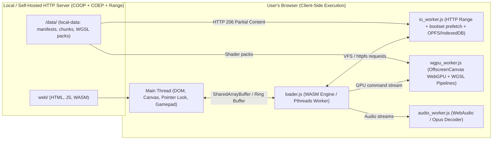

# playgta6web

An experimental, self-hosted browser runtime and asset-streaming architecture for **Grand Theft Auto VI (Xbox Series)** — designed so the **user's browser** runs the engine locally via **WebAssembly + WebGPU + HTTP Range streaming**, rather than server-side video streaming.

Inspired by the browser worker architecture of [shadany7824/playgta5](https://github.com/shadany7824/playgta5) and building on the open-source Xbox Series reverse-engineering, RPF9 decoding, and RDNA2 shader-translation work in [ItsNotRexed/Leonida](https://github.com/ItsNotRexed/Leonida).

> [!IMPORTANT]
> **No copyrighted game files are included in this repository.**
> This repo contains zero game binaries, keys, `.rpf` archives, shaders, or extracted assets, and it does not bypass DRM or distribute game files. You must supply your own local copy of the files. Everything generated by local build/pipeline tools stays in gitignored directories (`local-data/`, `work/`, `extracted/`) for personal/self-hosted use only.

---

## Status

**Planning / Architecture phase.**

`ItsNotRexed/Leonida` (the native x86-64 PC port effort) does not boot the game yet, and GTA 6 has **no available C++ source code** (unlike `playgta5`, which was compiled from leaked GTA V C++ source via Emscripten). Because of that, this project is structured in progressive phases:

1. **Build the browser streaming shell & WebGPU runtime now** (map chunks, models, textures, audio, and WGSL shader tests running in the browser).
2. **Track and adapt `Leonida`'s shader & runtime research** toward a future Wasm64 + WebGPU execution backend.

---

## How It Works (Architecture)



### Key Technical Challenges (Why This Is Harder Than `playgta5`)

| Area | `playgta5` (GTA V) | `playgta6web` (GTA VI Xbox Series) | Our Approach |
| :--- | :--- | :--- | :--- |
| **CPU Code** | Compiled directly from C++ source with Emscripten (`wasm32`, ~63 MB `game.wasm`). | Only compiled **Xbox Series x86-64** machine code exists (no C++ source). | Phase 1–2: Custom Rust/C++→WASM streaming runtime for assets/world. Phase 3–4: Research static x86-64 → LLVM IR → **Wasm64** lifting + Xbox OS shims (`xgameruntime`, `XTaskQueue`). |
| **Memory** | Fits inside `wasm32` (<4 GB RAM); ~19.7 GB data mirror. | Targets 16 GB unified memory; >100 GB package. | Mandatory **HTTP Range streaming** (`io_worker.js` + `bootset.json` + OPFS cache) and **Wasm64 (`memory64`)** for full runtime execution. |
| **GPU / Shaders** | D3D11 → WebGPU worker (`wgpu_worker.js`) + prebuilt WGSL packs. | `d3d12_xs` + precompiled **RDNA2 (`gfx1013`)** shaders using mesh shaders, wave64, bindless, and ray tracing. | Leverage `Leonida`'s `rdna2spirv.py` with `--mesh-compute` & `--wave64-emulate`, then lower **SPIR-V → WGSL** via `naga`/`tint` (with fallbacks for features WebGPU lacks, such as hardware RT and mesh shaders). |
| **Threading** | Emscripten pthreads via `SharedArrayBuffer`. | Multi-threaded engine + async I/O + render thread. | Strict **Cross-Origin Isolation** (`COOP: same-origin`, `COEP: require-corp`), dedicated `io_worker` + `wgpu_worker` (`OffscreenCanvas`), zero blocking work on the main thread. |

---

## Planned Repository Structure

```text
playgta6web/
├── .gitignore                 # Keeps all local game files, archives, and build outputs out of git
├── README.md
│
├── web/                       # Browser frontend & dedicated workers (modeled on playgta5)
│   ├── index.html             # Fullscreen canvas, boot progress UI, WebGPU & COOP/COEP checks
│   ├── loader.js              # Bootstraps workers, streams/instantiates WASM, IndexedDB /userdata
│   ├── workers/
│   │   ├── io_worker.js       # HTTP Range-request VFS + bootset.json prefetch + OPFS cache
│   │   ├── wgpu_worker.js     # OffscreenCanvas WebGPU backend + WGSL pipeline cache
│   │   └── audio_worker.js    # AudioWorklet Ogg Opus stream decoder
│   └── input/
│       └── input_bridge.js    # Pointer Lock, keyboard/mouse, Gamepad API -> SharedArrayBuffer
│
├── engine/                    # Client-side WASM core (Rust or C++/Emscripten)
│   ├── src/
│   │   ├── vfs/               # Virtual filesystem calling into io_worker (RPF9 chunk reader)
│   │   ├── render/            # WebGPU command encoder, LOD/chunk streamer, material system
│   │   └── sim/               # Camera, collision/physics, world streaming loop
│   └── build.ps1              # Compiles engine -> web/dist/engine.wasm
│
├── pipeline/                  # Offline local asset & shader prep (runs against user's --game dir)
│   ├── prepare_assets.py      # Indexes local RPF9 archives -> data-manifest.json & bootset.json
│   ├── pack_textures.py       # BCPack/TTPF -> WebGPU-ready BC7/KTX2 mip streams
│   ├── pack_audio.py          # AWC/XMA2 -> Ogg Opus stream chunks
│   └── shaders/
│       └── spirv_to_wgsl.py   # Translates Leonida SPIR-V (--mesh-compute) -> Naga/Tint -> WGSL packs
│
├── server/                    # Lightweight local / LAN HTTP server
│   ├── serve_local.py         # Serves web/ + /data/ with Range (206) + COOP/COEP headers
│   └── Launch-Local.cmd       # One-click Windows launcher
│
├── third_party/               # Reference git submodules (no game data)
│   └── leonida/               # Optional submodule pointing to ItsNotRexed/Leonida
│
└── local-data/                # GITIGNORED: locally generated manifests, stream chunks, shader packs
```

---

## Roadmap & How to Split Work

If you and a friend are collaborating, the architecture splits cleanly down the middle so you don't step on each other's toes:

### Track 1 — Browser Shell, Streaming I/O & WebGPU Worker (`server/`, `web/`, `engine/`)
- [ ] **M1: Dev Server & Worker Bootstrapping**
  - Build `server/serve_local.py` with `Cross-Origin-Opener-Policy: same-origin`, `Cross-Origin-Embedder-Policy: require-corp`, and HTTP `Range` (`206 Partial Content`) support.
  - Scaffold `web/index.html`, `web/loader.js`, `web/workers/io_worker.js`, and `web/workers/wgpu_worker.js` with `OffscreenCanvas` WebGPU init and a shared progress `BroadcastChannel`.
- [ ] **M2: Streaming VFS & Input**
  - Implement `bootset.json` prefetching + byte-range caching in `io_worker.js` (OPFS / Cache API) and save-data persistence in IndexedDB (`/userdata`).
  - Wire Pointer Lock, keyboard/mouse, and Gamepad API into a `SharedArrayBuffer` ring buffer.
- [ ] **M3: WebGPU World & Asset Renderer**
  - Stream and render extracted map chunks, LODs, BC7/KTX2 textures, and Opus audio in `wgpu_worker.js` + `engine/` WASM core.

### Track 2 — Local Asset & Shader Pipeline (`pipeline/`, `Leonida` integration)
- [ ] **M1: Manifest & RPF9 Indexing**
  - Wrap `Leonida`'s `rpf9dump` / `rpf9-explorer` to generate `data-manifest.json` and spatial chunk indices from a local `--game` folder without duplicating the full 100+ GB package.
- [ ] **M2: WebGPU-Compatible Asset Packing**
  - Convert BCPack/TTPF textures into streamable BC7/KTX2 mip chains and AWC/XMA2 audio into Ogg Opus.
- [ ] **M3: RDNA2 → SPIR-V → WGSL Experiments**
  - Run `Leonida`'s `rdna2spirv.py` with `--mesh-compute --wave64-emulate` and test lowering the resulting SPIR-V to WGSL with `naga` / `tint`, logging unsupported SPIR-V capabilities and required fallbacks.

### Track 3 — Long-Term Execution Runtime (Research / Future)
- [ ] Track `ItsNotRexed/Leonida` as it reaches first boot on native x86-64/Vulkan.
- [ ] Prototype Xbox OS shim surface (`xgameruntime`, `XTaskQueue`, virtual filesystem) and evaluate Wasm64 static recompilation (`x86-64 → LLVM IR → wasm64`) + `d3d12_xs → WebGPU` command translation.

---

## Contributing Rules

1. **Never commit game files or derived copyrighted data** (`.rpf`, `.xvd`, `.exe`, `.dll`, extracted meshes/textures/audio, translated game shaders, or dumps). Keep all local data inside `local-data/` or `work/` (both gitignored).
2. Keep `web/` dependency-light and verify Cross-Origin Isolation (`self.crossOriginIsolated === true`) in Chrome/Edge with WebGPU enabled.
3. Document any format findings, WebGPU limits, or WGSL translation blockers in `docs/`.

---

## References & Prior Art

- [shadany7824/playgta5](https://github.com/shadany7824/playgta5) — Reference browser worker architecture (`loader.js`, `io_worker.js`, `wgpu_worker.js`, HTTPFS range streaming, IndexedDB userdata).
- [ItsNotRexed/Leonida](https://github.com/ItsNotRexed/Leonida) — Native PC recompilation project for GTA VI (Xbox Series): RPF9 tooling, RDNA2 → SPIR-V shader translator, and `d3d12_xs` → Vulkan runtime research.
- [breadbbbb/rpf9-explorer](https://github.com/breadbbbb/rpf9-explorer) — Open-source RPF9 model, texture-pool, and AWC decoders.
