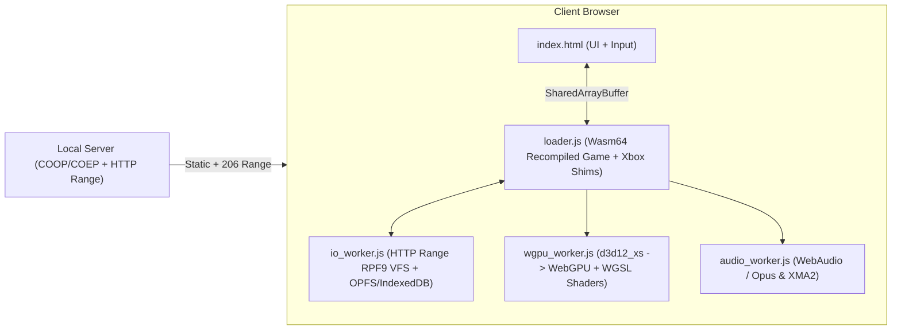

# playgta6web

An experimental, self-hosted project to run **Grand Theft Auto VI (Xbox Series)** directly inside the **user's browser** via **Wasm64 + WebGPU + HTTP Range streaming** — no server-side video streaming.

We reuse what we can from [shadany7824/playgta5](https://github.com/shadany7824/playgta5) (browser worker/streaming model) and [ItsNotRexed/Leonida](https://github.com/ItsNotRexed/Leonida) (RDNA2 shader translation & Xbox runtime research) to speed up development.

> [!IMPORTANT]
> **No game files are in this repo.** No binaries, keys, `.rpf` archives, or extracted assets. Supply your own local copy; all local data stays in gitignored folders (`local-data/`, `work/`).

---

## Architecture

### Core Components Needed to Run the Real Game in Browser
1. **CPU (x86-64 → Wasm64):** Lift/recompile the Xbox Series x86-64 executable to **Wasm64 (`memory64`)** + pthread worker support (`SharedArrayBuffer`) to handle the >4 GB address space.
2. **OS Shims (`runtime/`):** Reimplement required Xbox Series / Win32 APIs (`xgameruntime`, `XTaskQueue`, threading/TLS, virtual memory, file I/O, GameInput) backed by browser APIs.
3. **GPU (`d3d12_xs` → WebGPU + WGSL):** Lower RDNA2 (`gfx1013`) shaders (`--mesh-compute`, `--wave64-emulate`) → SPIR-V → **WGSL** (`naga`/`tint`), and map `d3d12_xs` command lists to WebGPU inside `wgpu_worker.js` (`OffscreenCanvas`).
4. **Streaming I/O (`io_worker.js`):** Serve local `.rpf` archives on demand via HTTP `206 Partial Content` range requests + `bootset.json` prefetch + OPFS/IndexedDB caching.
