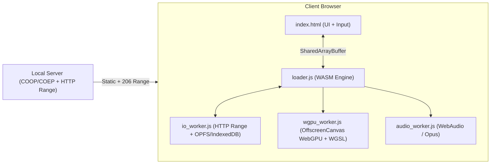

# PlayGreg6Web

An experimental, self-hosted browser runtime for **an Xbox Series title** — built so the **user's browser** runs everything locally via **WebAssembly + WebGPU + HTTP Range streaming** (no server-side video streaming).

> [!IMPORTANT]
> **No game files are in this repo.** No binaries, keys, `.rpf` archives, or extracted assets. Supply your own local copy; all local data stays in gitignored folders (`local-data/`, `work/`).

---

## Architecture



### Main Technical Hurdles
- **No C++ source code:** Only compiled Xbox Series x86-64 binaries are available. Short-term we build a WASM/WebGPU world & asset runtime; long-term running original game code in-browser requires x86-64 → **Wasm64** recompilation + Xbox API shims.
- **WebGPU limits:** No mesh shaders, no hardware ray tracing, no raw SPIR-V. RDNA2 shaders need lowering (`--mesh-compute`, `--wave64-emulate`) → SPIR-V → **WGSL** (`naga`/`tint`).
- **Size & Memory:** >100 GB package / 16 GB target RAM requires strict **HTTP `206` Range streaming** (`io_worker.js` + `bootset.json` + OPFS cache) and **Cross-Origin Isolation** (`COOP`/`COEP`) for `SharedArrayBuffer`.

---

## Repo Layout

```text
PlayGreg6Web/
├── web/          # index.html, loader.js, io_worker.js, wgpu_worker.js, audio_worker.js, input
├── engine/       # Rust/C++ -> WASM core (VFS, WebGPU streamer/renderer, sim)
├── pipeline/     # Offline local tools: RPF9 indexing, BC7/KTX2 textures, Opus audio, SPIR-V -> WGSL
├── server/       # Local HTTP server with COOP/COEP + Range (206) support
└── local-data/   # GITIGNORED: local manifests, streamed chunks, shader packs
```

---

## Roadmap (How to Split Work)

**Track 1 — Browser & Server (`server/`, `web/`, `engine/`)**
- [ ] `server/serve_local.py` with `COOP`/`COEP` headers + HTTP Range (`206`)
- [ ] `web/` worker shell (`loader.js`, `io_worker.js`, `wgpu_worker.js` with `OffscreenCanvas` WebGPU)
- [ ] Input bridge (Pointer Lock, KB/M, Gamepad → `SharedArrayBuffer`) + IndexedDB `/userdata`
- [ ] WASM/WebGPU chunk streamer & renderer

**Track 2 — Assets & Shaders (`pipeline/`)**
- [ ] Index local RPF9 archives → `data-manifest.json` + `bootset.json`
- [ ] Pack textures (BC7/KTX2) and audio (Ogg Opus) for browser streaming
- [ ] Test RDNA2 → SPIR-V → WGSL (`naga`/`tint`) shader conversion & document blockers

**Track 3 — Long-Term Runtime**
- [ ] Xbox OS shim layer (`xgameruntime`, `XTaskQueue`) + Wasm64 static recompilation & `d3d12_xs` → WebGPU backend
