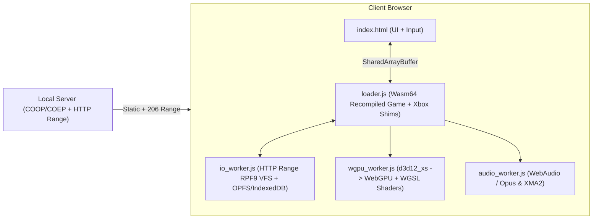

# PlayGreg6Web

An experimental, self-hosted project to run **an Xbox Series title** directly inside the **user's browser** via **Wasm64 + WebGPU + HTTP Range streaming** — no server-side video streaming.

> [!IMPORTANT]
> **No game files are in this repo.** No binaries, keys, `.rpf` archives, or extracted assets. The game data comes from a copy you own. If you play locally, that copy is on your machine. If you self-host the server, the copy lives on the server, which only streams the game files; the game itself always runs in the browser on your laptop, tablet or phone, so those devices don't need their own copy. Don't host it for people who don't own the game. All local data stays in gitignored folders (`local-data/`, `work/`).

---

## Architecture

### Core Components Needed to Run the Real Game in Browser
1. **CPU (x86-64 → Wasm64):** Lift/recompile the Xbox Series x86-64 executable to **Wasm64 (`memory64`)** + pthread worker support (`SharedArrayBuffer`) to handle the >4 GB address space.
2. **OS Shims (`runtime/`):** Reimplement required Xbox Series / Win32 APIs (`xgameruntime`, `XTaskQueue`, threading/TLS, virtual memory, file I/O, GameInput) backed by browser APIs.
3. **GPU (`d3d12_xs` → WebGPU + WGSL):** Lower RDNA2 (`gfx1013`) shaders (`--mesh-compute`, `--wave64-emulate`) → SPIR-V → **WGSL** (`naga`/`tint`), and map `d3d12_xs` command lists to WebGPU inside `wgpu_worker.js` (`OffscreenCanvas`).
4. **Streaming I/O (`io_worker.js`):** Serve local `.rpf` archives on demand via HTTP `206 Partial Content` range requests + `bootset.json` prefetch + OPFS/IndexedDB caching.
