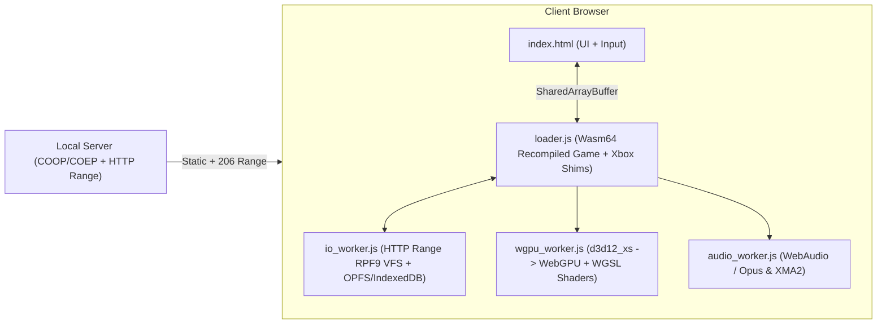

# PlayGreg6Web

An experimental, self-hosted project to run **an Xbox Series title** directly inside the **user's browser** via **Wasm64 + WebGPU + HTTP Range streaming** — no server-side video streaming.

> [!IMPORTANT]
> **No game files are in this repo.** No binaries, keys, `.rpf` archives, or extracted assets. Supply your own local copy; all local data stays in gitignored folders (`local-data/`, `work/`).

---

## Architecture



### Core Components Needed to Run the Real Game in Browser
1. **CPU (x86-64 → Wasm64):** Lift/recompile the Xbox Series x86-64 executable to **Wasm64 (`memory64`)** + pthread worker support (`SharedArrayBuffer`) to handle the >4 GB address space.
2. **OS Shims (`runtime/`):** Reimplement required Xbox Series / Win32 APIs (`xgameruntime`, `XTaskQueue`, threading/TLS, virtual memory, file I/O, GameInput) backed by browser APIs.
3. **GPU (`d3d12_xs` → WebGPU + WGSL):** Lower RDNA2 (`gfx1013`) shaders (`--mesh-compute`, `--wave64-emulate`) → SPIR-V → **WGSL** (`naga`/`tint`), and map `d3d12_xs` command lists to WebGPU inside `wgpu_worker.js` (`OffscreenCanvas`).
4. **Streaming I/O (`io_worker.js`):** Serve local `.rpf` archives on demand via HTTP `206 Partial Content` range requests + `bootset.json` prefetch + OPFS/IndexedDB caching.

---

## Repo Layout

```text
PlayGreg6Web/
├── web/          # index.html, loader.js, io_worker.js, wgpu_worker.js, audio_worker.js, input
├── recomp/       # x86-64 -> LLVM IR -> Wasm64 static recompilation pipeline
├── runtime/      # Xbox/Win32 OS shims + d3d12_xs -> WebGPU command bridge (compiled to Wasm64)
├── shaders/      # RDNA2 -> SPIR-V -> WGSL (naga/tint) offline shader packer & index
├── server/       # Local HTTP server with COOP/COEP + Range (206) support
└── local-data/   # GITIGNORED: local game data, manifests, recompiled wasm, WGSL packs
```

---

## Roadmap (How to Split Work)

**Track 1 — Browser Host, Streaming VFS & WebGPU Backend (`server/`, `web/`, `runtime/`)**
- [ ] `server/serve_local.py` with `COOP`/`COEP` headers + HTTP Range (`206`)
- [ ] `web/` worker shell (`loader.js`, `io_worker.js`, `wgpu_worker.js` with `OffscreenCanvas` WebGPU)
- [ ] Input bridge (Pointer Lock, KB/M, Gamepad → `SharedArrayBuffer`) + IndexedDB `/userdata`
- [ ] `d3d12_xs` → WebGPU command buffer bridge & Xbox OS shims (`xgameruntime`, `XTaskQueue`, VFS)

**Track 2 — Recompilation & Shader Pipeline (`recomp/`, `shaders/`)**
- [ ] Static x86-64 PE loader & lifting pipeline (`x86-64 → LLVM IR → Wasm64`)
- [ ] RDNA2 → SPIR-V (`--mesh-compute`, `--wave64-emulate`) → WGSL (`naga`/`tint`) packer & `shader-index.json`
- [ ] `data-manifest.json` + `bootset.json` generator for range-streaming local `.rpf` files
